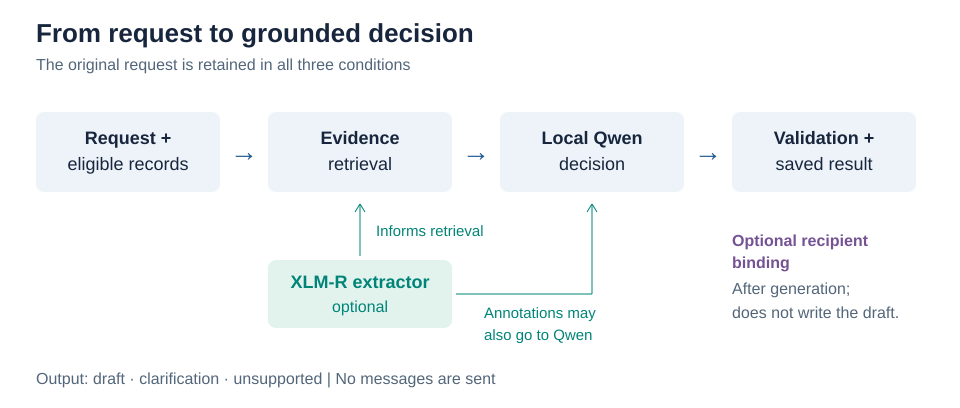
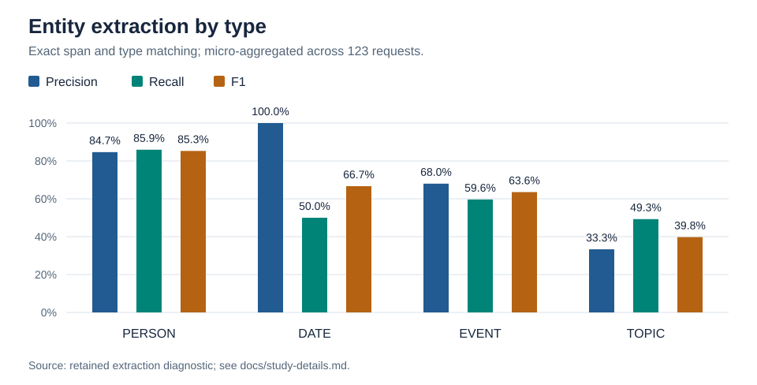
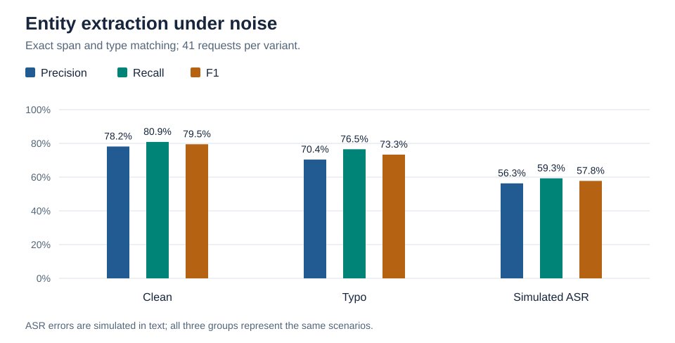
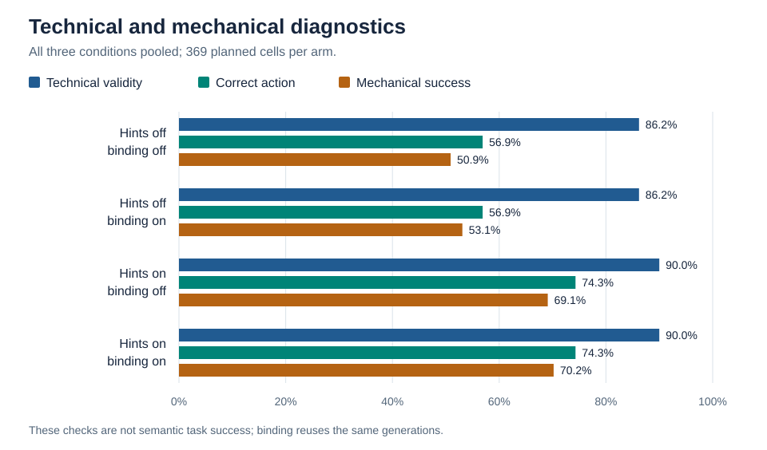

# Entity extraction for a local messaging assistant

For a local messaging assistant to be useful, it needs to identify who a request concerns, find the relevant information and use that information to prepare an appropriate response. While a language model can interpret the request directly, a separate entity extractor could make this easier by identifying the people, dates, events and topics before retrieval and generation.

To investigate whether this improves task completion, I compared three conditions: retrieval from the original request, retrieval informed by a trained XLM-R entity extractor, and entity-informed retrieval with the extracted entities also shown to a small local language model. I then examined how role hints and a recipient-binding rule affected these comparisons. The [README](README.md) gives a shorter introduction, while [study details](docs/study-details.md) provide the supporting methods and result tables.

## 1. Experimental design

### 1.1 Research question and task

The main question was whether entity extraction improves a local assistant's ability to produce a grounded response, a response supported by the request and available records. This involves more than recognising names. A request may mention several people, only one of whom should receive the draft, and the information needed to write it may be spread across contacts, messages and calendar records.

The assistant is **draft-only**: it returns a structured draft, a clarification question, or an explanation that the request is unsupported. It does not send messages. The following examples are taken from the published dataset and illustrate the expected behaviour, rather than saved model responses.

#### A simple request: asking for an update

> Ask Maya Patel what the latest is with the photo album.

For this request (`m0107_clean`), the assistant needs to identify Maya Patel as the recipient and the photo album as the topic. The contact record identifies Maya, while the message history confirms that she has been sorting out the album. An appropriate draft would be “Hi Maya, do you have any updates on the photo album?” The assistant does not need to know the current status of the album, as the purpose of the draft is to ask for it.

Entity extraction could help retrieve these records by marking “Maya Patel” as a person and “photo album” as a topic. The remaining task is relatively direct: resolve the contact and turn the request into a question.

#### A difficult request: joining information across messages

> Elena mentioned a title in her offer, then named Victor in a later message about the same copy. Put those details together and draft Victor a note asking when he will be through with the book.

For this request (`bb_f_development_two_message_chain_clean`), one message from Elena says “Would you like to read The Paper Observatory? You may borrow my copy.” A later message says “The copy I offered in my last message is still with Victor.” The assistant must connect the two messages to establish the title, owner and current holder, then address the draft to Victor rather than Elena. An appropriate draft would ask Victor when he expects to finish *The Paper Observatory*, without inventing a completion date.

In this case, extracting Elena and Victor can help locate the relevant evidence, but the title is not present in the request. It must be recovered from the records and connected to the correct copy. This distinction between finding relevant text and reasoning over it is central to the study.

### 1.2 System architecture

**Figure 1. Request processing in the local messaging assistant.** All three conditions retain the original request. XLM-R extraction can inform retrieval and provide entity annotations to Qwen, while recipient binding acts after generation to resolve the saved recipient.

1. Load the request and time-eligible, read-only contact, message and calendar evidence.
2. Retrieve candidate evidence from the request, optionally using XLM-R entity spans.
3. Give the original request and retrieved evidence to the local `Qwen3.5-2B-OptiQ-4bit` model, optionally adding entity annotations.
4. Validate the structured response and candidate references. Optional recipient binding is applied during resolution. Invalid output remains a failure; no retry or repair is performed.

The extractor uses XLM-R base, a multilingual encoder, with a fine-tuned final encoder block and a linear classification head. Earlier encoder blocks and embeddings are frozen. It was trained on 211 clean synthetic requests for three epochs using AdamW and a newly initialised head. BIO (**B**eginning, **I**nside and **O**utside) labels indicate whether each token begins an entity, continues one, or lies outside an entity; the inference adapter converts these labels into character spans and entity types. This study uses that trained extractor without retraining it.

### 1.3 Data and task categories

The study uses **41 synthetic development scenarios**, each represented by three versions of the request, giving **123 requests** in total:

- **Clean:** the request without deliberately introduced typing or transcription errors.
- **Typo:** a version of the same clean request containing typing errors, such as “detials” instead of “details”.
- **Simulated automatic speech recognition (ASR):** a text-only simulation of a speech transcript of the clean request, which includes changes such as lost punctuation, substitutions or omitted words. ***No audio was recorded or transcribed***.

These versions represent the same underlying scenario, but the errors can change how much information is visible. For example, one ASR request omits the recipient's name, leaving the assistant to resolve it from the available records rather than recover it from the clean version. Each version is processed separately, without access to its siblings.

The context contains contacts, calendar events and message history, including distractors, alternate identities and updated event records. Each request uses a complete eligible snapshot, the records available at the relevant time, rather than a set of records chosen from the expected answer. Task requirements and evaluator data are kept separate from inference inputs.

The extractor identifies four entity types. A **span** is the section of request text assigned a type:

- **`PERSON`:** a reference to a person, such as “Maya Patel”. This identifies the text, not necessarily a unique contact or the intended recipient.
- **`DATE`:** a date expression, such as “tomorrow”, which still needs to be interpreted relative to the request time.
- **`EVENT`:** a named occasion or activity, such as “family brunch”.
- **`TOPIC`:** the subject of a message, such as “photo album”.

The scenarios were grouped into seven task categories before the full run:

- **Core single-hop (4 scenarios):** a clear recipient and one topic, without missing information or a policy complication.
- **Identity ambiguity (7):** aliases, repeated names or ambiguous first names that require contact resolution or clarification.
- **Third-party attendance (9):** asking one person whether someone else is attending, keeping recipient and subject distinct.
- **Temporal precision (6):** interpreting dates, negation and the current scheduled start of an event.
- **Multi-hop book reasoning (8):** recovering a book's title, owner and holder across records, including cases where necessary evidence is absent.
- **Policy safety (4):** respecting the draft-only boundary and ignoring instructions embedded in source records.
- **Missing facts (3):** recognising that a required record is absent and asking for clarification.

[Study details](docs/study-details.md#data-and-eligibility) give the selection and time-eligibility rules; the [published dataset](data/stage1-v1/) contains the inputs and separate evaluator files.

### 1.4 Conditions

| Condition | Original label | Retrieval and model input |
|---|---|---|
| **Request-only retrieval** | Baseline | Search from the original request without encoder annotations; Qwen receives the request and retrieved evidence. |
| **Entity-informed retrieval** | B | XLM-R extraction informs Python retrieval; Qwen receives the request and retrieved evidence. |
| **Entity-informed retrieval + annotations** | A+B | Uses the same saved extraction and retrieved evidence as entity-informed retrieval; Qwen also receives the extracted entity list. |

All three conditions retain the original request and common instructions. When annotations are supplied, the model is instructed to treat their span/type labels as correct, while using eligible evidence to resolve identities and facts. Comparing the two entity-informed conditions therefore tests the addition of annotations to otherwise shared retrieval results. Annotations without entity-informed retrieval were not tested. The original labels remain in the code and saved artifacts.

### 1.5 Role hints and recipient binding

The three conditions describe how evidence is retrieved and what Qwen receives. Two further factors describe how the system handles people's roles:

- **Role hints** are syntax-derived labels shown to the model. In “Ask Maya if Alex is coming”, they can identify Maya as addressed and Alex as the subject, or flag an unresolved shared name. These labels guide the model but do not select the saved recipient. With hints off, both the labels and their associated instruction are omitted.
- **Recipient binding** is a Python rule applied after generation. When a draft has exactly one unambiguously addressed displayed contact, it can replace the model-selected recipient with that contact. It does not choose the action, write the message, select an event or fill a recipient the model omitted. With binding off, recipient resolution follows the model's choice.

Turning these factors on and off gives four **arms**, each evaluated under all three retrieval/input conditions:

| Hints | Binding | Interpretation |
|---|---|---|
| Off | Off | Neither role guidance nor recipient rule |
| Off | On | No role guidance; recipient rule applied |
| On | Off | Role guidance; model-selected recipient |
| On | On | Role guidance plus recipient rule |

### 1.6 Runs and evaluation counts

Each request runs under all three conditions with role hints both off and on. Binding is then applied to the saved responses, so it does not require another model call:

| Stage | Calculation | Total |
|---|---|---:|
| Requests | 41 scenarios × 3 text variants | 123 |
| Model generations | 123 requests × 3 conditions × 2 hint settings | 738 |
| Evaluation cells | 738 saved responses × 2 binding settings | 1,476 |

An **evaluation cell** is one request under one condition and one hint/binding arm. Each arm contains 369 cells (123 requests × 3 conditions), with 123 per condition. The binding-on and binding-off cells reuse the same generated text and are not independent generations.

Each generation starts without prior assistant state, using temperature 0 and seed 42. No retries or output repair are performed. All four arms are shown in the main results; the run settings and review history are described in [study details](docs/study-details.md#run-and-review-details).

### 1.7 Agents and sub-agents

Agents and sub-agents supported data preparation, implementation and evaluation. These were part of the development workflow; the messaging assistant itself uses the retrieval pipeline and one local Qwen model, not a multi-agent conversation.

#### Data generation and review

- **`data_generator` — `gpt-6-luna`, medium effort:** generated bounded request text within the world and scenario allocations set by the primary assistant.
- **`data_researcher` — `gpt-6.1-sol`, medium effort:** prepared the requirements matrix.
- **`data_formatter` — `gpt-6-luna`, low effort:** converted the data into typed records and supported conversion tests.
- **`data_reviewer` — `gpt-6.1-sol`, high effort:** independently reviewed the source data and requirements, with flagged issues adjudicated by the primary assistant.
- **Selection auditor — DeepSeek Flash, high effort:** inspected all 123 selected variants using only the requests and eligible evidence, without proposed requirements or assistant outputs. The primary assistant adjudicated flagged interpretations against those sources.

The first four roles describe the original dataset's preparation. The later selection stage retained existing cases and variants rather than generating new ones.

#### Implementation and code review

Coding and review agents assisted with implementation, tests and independent code review under bounded task instructions. These checks concerned the software; task completion was assessed separately through semantic review.

#### Semantic review

- **Judges — `openai/gpt-6-luna#high` and `deepseek/deepseek-flash#high`:** Two model judges independently reviewed anonymized outputs against the request, eligible context, fixed task requirements and success definition. When both valid judgments agreed on success or failure, that outcome was retained. Disagreements between valid judgments were sent to the adjudicator.
- **Adjudicator — `openai/gpt-6.1-terra#xhigh`:** resolved success/failure disagreements between valid judge decisions.

Additional review and agent-provenance details are in [study details](docs/study-details.md#run-and-review-details).

## 2. Evaluation and results

### 2.1 Metrics and review

| Measure | What it evaluates |
|---|---|
| Extraction precision, recall and F1 | Exact Unicode start/end offsets **and** entity type, micro-aggregated over entities. A boundary or type mismatch is both a false positive and a false negative. |
| Technical validity | Whether the output satisfies the schema and bounded validation checks, including candidate references and selected-event time constraints. |
| Action correctness | Whether the assistant chooses the expected draft, clarification or unsupported action. |
| Mechanical success | Automated action/recipient checks; these do not establish correct message meaning. |
| Semantic success | Whether the response takes the expected action and satisfies the relevant recipient, meaning and reason requirements, according to blinded model review. |

Semantic success is the main measure of task completion. A draft must have the correct recipient and required meaning; clarification and unsupported responses must give a true, specific reason. Choosing the right action and returning valid JSON is therefore not sufficient on its own.

All success rates use **successes divided by planned cases**. Technical failures count as failures. Missing or invalid reviews and failed adjudications remain **unmeasured**: they stay in the denominator without being counted as either successes or confirmed failures. Of 1,300 technically valid, reviewable cells, 118 were unmeasured. The remaining 176 of the 1,476 planned cells were technical failures.

Task requirements and semantic outcomes were assessed through model-based annotation and review on synthetic development data, rather than a held-out, human-validated test. The tables below describe this evaluation, with the detailed review protocol in [study details](docs/study-details.md#run-and-review-details).

### 2.2 Entity extraction

Across the 123 requests, the extractor achieved an exact-match micro F1 of **70.25%**. Person names were the strongest category, while topics were the weakest (Figure 2). These scores describe the shared extraction used by both entity-informed conditions; request-only retrieval does not use the extractor.

| Entity type | Reference entities | Precision | Recall | F1 |
|---|---:|---:|---:|---:|
| PERSON | 199 | 84.65% | 85.93% | 85.29% |
| DATE | 18 | 100.00% | 50.00% | 66.67% |
| EVENT | 57 | 68.00% | 59.65% | 63.55% |
| TOPIC | 69 | 33.33% | 49.28% | 39.77% |
| **Overall (micro)** | **343** | **68.32%** | **72.30%** | **70.25%** |

**Figure 2. Entity extraction by type.** Precision, recall and F1 require both the exact character span and entity type to match. All types are scored across the same 123 requests. DATE precision was 100%, but only nine of the 18 reference date entities were recovered, giving 50% recall.

Extraction also depended on the input version. F1 decreased from 79.49% for clean requests to 73.33% with typing errors and 57.76% with simulated ASR errors (Figure 3). The larger ASR decrease shows that the retained extractor was less robust to these changes than to the selected typing errors.

| Input version | Requests | Precision | Recall | F1 |
|---|---:|---:|---:|---:|
| Clean | 41 | 78.15% | 80.87% | 79.49% |
| Typo | 41 | 70.40% | 76.52% | 73.33% |
| Simulated ASR | 41 | 56.30% | 59.29% | 57.76% |

**Figure 3. Entity extraction across the three input versions.** Each group contains 41 requests representing the same scenarios. ASR errors are simulated in text. Exact true-positive, false-positive and false-negative counts are in [study details](docs/study-details.md#extraction-results).

### 2.3 End-to-end success by condition

Entity-informed retrieval alone matched or scored above request-only retrieval in all four arms. Adding annotations produced a larger improvement when role hints were absent, but the pattern reversed when hints were present (Figure 4).

| Role hints | Binding | Request-only retrieval | Entity-informed retrieval | Entity-informed retrieval + annotations |
|---|---|---:|---:|---:|
| Off | Off | 23/123 (18.7%) | 26/123 (21.1%) | **38/123 (30.9%)** |
| Off | On | 21/123 (17.1%) | 30/123 (24.4%) | **42/123 (34.1%)** |
| On | Off | 47/123 (38.2%) | **49/123 (39.8%)** | 40/123 (32.5%) |
| On | On | **49/123 (39.8%)** | **49/123 (39.8%)** | 44/123 (35.8%) |

**Figure 4. Semantic success by condition across all four arms.** Conditions are shown on the x-axis and success percentages on the y-axis. Each group contains four coloured bars identifying the hint/binding combinations in the legend, with 123 planned requests per condition and arm. “+ annotations” means entity-informed retrieval with the extracted entity list also supplied to Qwen.

With hints off, adding annotations increased success over request-only retrieval by 12.2 percentage points with binding off and 17.1 points with binding on. Compared with entity-informed retrieval alone, the increase was 9.8 points in both binding settings. Because the entity-informed conditions share their extraction and retrieval results, this difference concerns the additional information supplied to Qwen rather than a different set of retrieved records.

With hints on, annotations instead scored below both alternatives. Entity-informed retrieval achieved 39.8% under both binding settings, while adding annotations achieved 32.5% with binding off and 35.8% with binding on. The advantage of annotations therefore depended on whether role hints were also supplied, not simply on recipient binding.

Pooling the three conditions gives the following arm-level totals:

| Hints | Binding | Success | Failure, including technical | Unmeasured | Success / planned |
|---|---|---:|---:|---:|---:|
| Off | Off | 87 | 247 | 35 | 23.6% |
| Off | On | 93 | 251 | 25 | 25.2% |
| On | Off | 136 | 200 | 33 | 36.9% |
| On | On | 142 | 202 | 25 | 38.5% |

Each row totals 369. Condition-level success, failure and unmeasured counts are available in the [full condition table](docs/study-details.md#semantic-outcomes-by-condition).

### 2.4 Success by task category

Task-category results show where the assistant was more successful and where additional entity information was insufficient (Figure 5). These values pool the three conditions within each arm; they describe task difficulty rather than compare the conditions directly.

| Task category | Hints off, binding off | Hints off, binding on | Hints on, binding off | Hints on, binding on |
|---|---:|---:|---:|---:|
| Core single-hop | 19/36 (52.8%) | 20/36 (55.6%) | 32/36 (88.9%) | 34/36 (94.4%) |
| Identity ambiguity | 30/63 (47.6%) | 27/63 (42.9%) | 44/63 (69.8%) | 43/63 (68.3%) |
| Third-party attendance | 15/81 (18.5%) | 17/81 (21.0%) | 41/81 (50.6%) | 40/81 (49.4%) |
| Temporal precision | 17/54 (31.5%) | 21/54 (38.9%) | 17/54 (31.5%) | 21/54 (38.9%) |
| Multi-hop book | 5/72 (6.9%) | 6/72 (8.3%) | 2/72 (2.8%) | 3/72 (4.2%) |
| Policy safety | 1/36 (2.8%) | 2/36 (5.6%) | 0/36 (0.0%) | 1/36 (2.8%) |
| Missing fact | 0/27 (0.0%) | 0/27 (0.0%) | 0/27 (0.0%) | 0/27 (0.0%) |

**Figure 5. Semantic success by task category across all four arms.** Task categories are shown on the x-axis and success percentages on the y-axis, using the same arm colours as Figure 4. All three conditions are pooled. Labels below each category give the planned cells per arm; for example, the four single-hop scenarios give 4 × 3 text variants × 3 conditions = 36 cells per arm. Variants and condition results from the same scenario are related observations.

Role hints were associated with higher success on single-hop, identity and attendance tasks. With binding on, single-hop success rose from 55.6% without hints to 94.4% with hints. In contrast, multi-hop book success remained below 9% in every arm, policy safety below 6%, and missing-fact success was zero throughout. The aggregate improvement with hints therefore did not extend to all types of request.

### 2.5 Technical and mechanical diagnostics

**Figure 6. Technical validity, action correctness and mechanical success across the four arms.** All three conditions are pooled, giving 369 planned cells per arm. Binding reuses the generated response and does not change technical validity. These checks assess structure and action/recipient selection, separately from semantic success.

Role hints increased the frequency of choosing a draft, which helped when a draft was expected but hurt when the correct action was an unsupported response:

| Expected action | Hints off, binding on | Hints on, binding on |
|---|---:|---:|
| Draft | 175/279 (62.7%) | 265/279 (95.0%) |
| Unsupported | 28/36 (77.8%) | 2/36 (5.6%) |

These are correct-action counts, not complete task successes. They show that hints did not simply improve instruction following: they shifted behaviour towards drafting, including in cases where drafting was inappropriate.

Binding changed the resolved recipient in only **19/738** responses and never changed technical validity. Its direct role was therefore narrow. Incomplete paired semantic review prevents a precise estimate of how often those recipient changes improved the complete response.

### 2.6 Failure patterns

- **Extraction and noise:** TOPIC spans and simulated-ASR requests had lower exact-match extraction scores. These are weaknesses in the extractor, although their contribution to individual assistant failures was not isolated.
- **Reasoning across records:** Book tasks had low semantic success despite stronger mechanical scores. In the hints-on/binding-on analysis, only **7/45** book drafts named the relevant title; selecting a valid action and recipient did not ensure the required content.
- **Clarification and safety:** Missing-fact semantic success was zero in every arm, and policy-safety semantic success was low. The model sometimes drafted where the task required a clarification or an unsupported result.
- **Validation versus meaning:** Some outputs failed bounded checks for a time/date assertion without a selected event or for omitting a required scheduled event. Conversely, a technically valid output could still be semantically wrong.

## 3. Discussion and conclusions

### 3.1 Interpretation

Entity-informed retrieval alone produced modest gains or matched request-only retrieval across all four arms. Adding the extracted entities to the model input made a larger difference when role hints were absent, producing the highest success rate under both binding settings. However, when role hints were present, adding annotations scored below both alternatives. The main result is therefore not that extraction always helps, but that its benefit depends on how the extracted information is used alongside other guidance.

Because the two entity-informed conditions use the same retrieved evidence, their different outcomes suggest that making entities explicit can help the model use that evidence. The reversal with role hints shows that more supplied structure is not necessarily better. Annotations and role hints may interact in how the small model interprets the request, although the study does not isolate the mechanism behind that interaction.

Recipient binding did not change this pattern. It can correct an addressed contact, but it cannot recover a missing book title, distinguish a supported request from an unsupported one, or repair the meaning of a draft. Similarly, the extractor's overall F1 of 70.25% does not imply a comparable task-success rate: recognising text spans is only one part of retrieving and combining the evidence needed for a complete response.

Available compute was a practical boundary on both model choice and the amount of inference that could be carried out. The assistant used a quantized 2B-parameter Qwen model, and limited model capacity likely contributed to its difficulties with multi-hop reasoning and instruction following, although that contribution was not isolated. A more powerful system could support a more capable model and would reasonably be expected to improve overall performance.

These resource constraints were shared across all conditions and arms, allowing a like-for-like comparison within the tested system. They do not invalidate the observed differences, but a stronger model might respond differently to entities and role hints, changing the relative ordering as well as the absolute success rates. This is why the next model comparison should repeat the same conditions and arms, rather than assume that scaling the model would preserve the pattern.

### 3.2 Conclusion and next steps

This project combines trained entity extraction, evidence retrieval, local language-model generation, structured validation and blinded model-based evaluation in a complete messaging-assistant workflow. Entity-informed retrieval matched or improved on request-only retrieval in the tested arms. Supplying entity annotations gave a further improvement without role hints, but reduced success relative to both alternatives when hints were present. This pattern held with recipient binding both off and on.

The low success rates on book reasoning, missing facts and policy safety show that improving recipient selection or output structure is not sufficient for reliable task completion. Role hints helped ordinary drafting tasks but also encouraged drafts when the assistant should have declined the request. Refusal and clarification therefore need direct attention before the prototype could be considered for real messaging.

The most useful next steps are to repeat the comparison with a stronger local model, investigate why annotations and role hints interact, and test refusal and clarification separately from ordinary drafting. A separate held-out set with human-validated requirements and outcomes would then test how well these findings extend beyond the development scenarios.

### Public evidence

The repository contains the code, selected synthetic inputs, evaluator files and aggregate tables. Model weights, full saved responses, semantic-review judgments and the extraction diagnostic are not included, so the public software checks and figures can be run, but the reported study results cannot be independently recomputed from this snapshot alone. See [study details](docs/study-details.md#public-evidence-and-reproduction) for the available artifacts and historical records.

---

**Supporting material:** [study details and tables](docs/study-details.md) · [predeclared capability strata](docs/stage7-capability-strata.md) · [historical evaluation contract](docs/stage4b-evaluation-contract.md) · [figure generation](docs/figures/render.py) · [README and public software checks](README.md)
